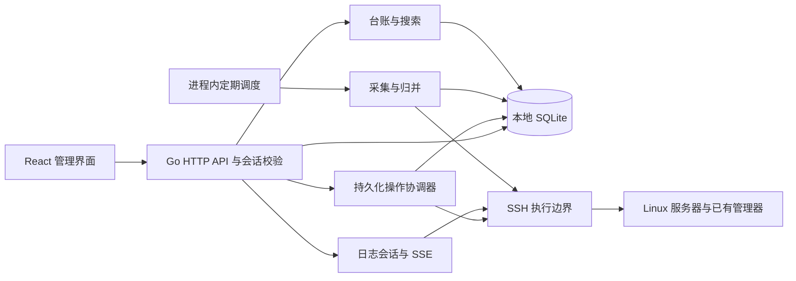
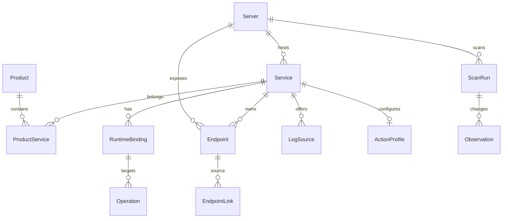
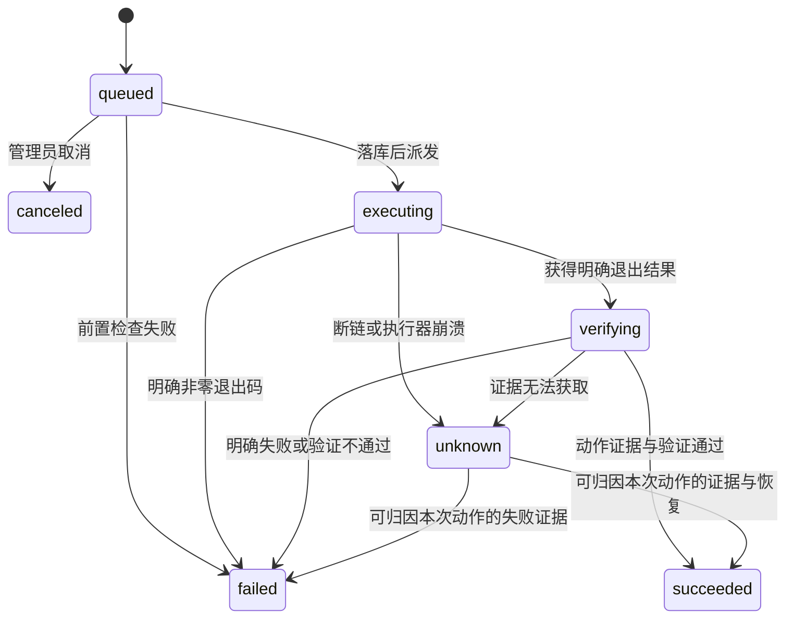

# 服务地图架构与数据设计

版本：1.0　日期：2026-10-08　状态：开发基线草案

服务地图采用单节点控制台，通过 SSH 读取 2–5 台 Linux 服务器的运行事实，将它们合并到稳定的服务台账。产品归属、用途备注和管理配置由管理员维护；采集负责更新运行事实。两类数据分开存储，使容器重建、进程重启和扫描失败不会破坏已经整理的关系。

本文约定后端模块、数据结构、采集合并和动作执行规则。接口及适配器详见 [接口与适配器设计](04-api-and-adapters.md)。技术栈是建议实施基线，开工时锁定维护中的兼容版本。

## 1 架构与模块职责

| 模块 | 职责 | 关联需求 |
|---|---|---|
| 身份与配置 | 单管理员登录、会话、CSRF、凭据加密、指纹确认 | F-01、F-02、F-14 |
| 台账 | 产品关联、别名备注、手工站点、归属确认 | F-04、F-06 |
| 采集协调器 | 能力探测、分来源采集、快照合并、变化摘要 | F-03、F-07、F-12 |
| 搜索与投影 | 查询本地缓存，聚合产品与服务器详情 | F-05、F-07 |
| 日志会话 | 来源选择、有限历史、跟随、断流和资源回收 | F-08 |
| 操作协调器 | 预览、幂等提交、目标锁、执行、核验、未知结果恢复 | F-09、F-10、F-11 |
| 数据维护 | 一致性备份、保留策略、恢复与迁移 | F-13、F-14 |

后端使用 Go `net/http`、`golang.org/x/crypto/ssh`，前端使用 React、TypeScript、Vite、Ant Design，数据库使用 SQLite WAL。Go 标准库没有 SQLite 驱动，实施时另选维护中的兼容驱动并锁版本，根据目标镜像决定纯 Go 或 CGO 方案。单进程承担 API、定时器和受限后台任务；数据库保存任务状态。无需 Redis、消息队列或常驻 Agent。日志和远端扫描不占用数据库事务。

控制台可以部署在其中一台服务器，但访问自身仍按显式配置的服务器连接处理。数据库放本地磁盘；WAL 不支持通过网络文件系统实现多主机共享，备份也不能随意复制活动数据库单文件。[SQLite WAL 官方说明](https://sqlite.org/wal.html)

首版只允许一个后端实例拥有调度与执行权。启动时取得数据目录的排他进程锁，失败则停止启动；以 SQLite 事务校验进一步防止重复领取操作。健康检查同时报告数据库、主密钥可用性与执行器是否正常，不能只返回 HTTP 存活。

## 2 对象边界

**Product 是业务产品，Service 是单台服务器上的稳定管理单元，RuntimeBinding 是它当前或历史的具体运行实例。** 一个产品可以关联多台机器上的服务；一个服务也可以作为共享资源关联多个产品。

Docker Compose 的一个明确服务或 PM2 的一个明确应用可以有多个实例绑定。只有管理器关系证明它们属于同一单元时才聚合；同名进程或相同端口不构成证明。首版重启默认针对一个 `target_binding_id`，不会隐式扩大到整组、整个产品或依赖项。

站点可以没有独立进程，后台任务可以没有监听端口。Nginx 的宿主机 443 监听属于 Nginx 运行单元，站点的域名和路径属于站点服务，用关系连接二者；共享监听不会因确认某个站点归属而变成该产品独占。

## 3 字段与存储约定

主键为后端生成的不可猜测 UUID，以下示例 `srv_01` 等仅便于阅读。时间存 UTC RFC 3339，界面显示 Asia/Shanghai。布尔值映射 SQLite INTEGER，结构化 JSON 以 TEXT 保存并校验 schema。必需查询、唯一性和关联的字段单独建列，不能都藏进 JSON。

可编辑对象有 `version` 正整数及 `created_at/updated_at`；更新须比对版本，冲突返回 409。原始输出采用字段白名单提取，不保存完整进程环境、Docker 环境变量或可能含密码的命令行。对确有用处的启动摘要先脱敏再存储。数据库开启外键；所有删除优先归档，避免破坏历史证据。

### 3.1 接入与台账

| 表 | 核心字段与类型 | 规则 |
|---|---|---|
| `servers` | `id`；`name` TEXT；`host` TEXT；`ssh_port` INTEGER；`ssh_user` TEXT；`credential_id` FK；`enabled` BOOL；`archived_at` TIME NULL；`scan_interval_seconds` INTEGER | 地址只允许 IP 或合法主机名；SSH 端口 1–65535；enabled 控制暂停；archived_at 控制归档，两者分开 |
| `servers` | `host_key_algorithm`、`host_key_public`、`host_key_fingerprint` TEXT；`host_key_verified_at` TIME | 已确认密钥是连接信任依据；新指纹不能由扫描覆盖 |
| `servers` | `identity_status`=`unverified/confirmed/ambiguous`；`physical_host_key` TEXT NULL；`host_identity_evidence_json` JSON | 首版同一物理主机一条 Server；别名和不同 SSH 用户不能绕过资源锁；未确认身份禁用写动作 |
| `servers` | `connection_status` ENUM；`coverage` ENUM；`last_scan_started_at`、`last_complete_scan_at` TIME；`capabilities_json` JSON | 整机覆盖和连接状态独立；来源级新鲜度另见扫描记录 |
| `servers` | `connection_config_version` INTEGER；`last_verified_connection_config_version` INTEGER NULL；`last_connection_test_at` TIME NULL | 地址/端口/SSH 用户/凭据改变递增连接配置版本；启用前须有当前版本的成功测试 |
| `servers` | `pm2_contexts_json` JSON；`allowed_log_roots_json` JSON；`allowed_script_roots_json` JSON；`collector_config_json` JSON | PM2 上下文明确列出用户、绝对 `PM2_HOME`、绝对可执行路径；目录不以字符串前缀判定 |
| `credentials` | `id`；`name`；`kind`=`private_key/password`；`ciphertext` BLOB；`nonce` BLOB；`key_id`；`created_at/rotated_at` | 私钥、口令、私钥解密口令一起加密；API 仅返回元数据；主密钥独立于数据库 |
| `products` | `id`；`name`；`description`；`environment`；`archived_at` | `environment` 为管理员自由标签；删除产品不删除服务器上的服务 |
| `services` | `id`；`server_id` FK；`kind`=`docker/systemd/pm2/site/unmanaged`；`is_stub` BOOL；`display_name`；`aliases_json`；`note`；`tags_json` | 台账字段采集不得覆盖；尚无归属的服务进入待整理；未知监听生成只读 unmanaged stub |
| `services` | `identity_key`；`identity_confidence`=`strong/confirmed/weak`；`identity_source`；`manager_context`；`generation` INTEGER；`archived_at` | 身份键只用于台账续接；generation 在绑定集合或管理目标改变时递增 |
| `services` | `runtime_state`；`health_state`；`runtime_observed_at`；`health_observed_at`；`inventory_status`=`present/missing/manual/archived`；`last_seen_at` | 状态是最新投影，来源与时间必须可回溯；missing 不等于进程已停止 |
| `product_services` | `product_id` FK；`service_id` FK；`role`=`owned/shared`；`confirmed_at`；`version` | 同一对关系唯一；首版每个服务至多一个 owned，允许多个 shared；用户可更改所有关系 |

产品名不强制全局唯一，以免不同环境同名；筛选时同时显示环境。新建产品时提示可能重复即可。服务归属记录独立于身份推断，未确认的建议放进 Observation 摘要，不能直接创建确认关系。

### 3.2 运行绑定与网络入口

| 表 | 核心字段与类型 | 规则 |
|---|---|---|
| `runtime_bindings` | `id`；`service_id` FK；`server_id` FK；`adapter`；`manager_context`；`external_id`；`resource_lock_key` | `external_id` 是容器完整 ID、明确 unit、PM2 上下文内 pm_id 或进程组合身份；不能直接接受浏览器传入值 |
| `runtime_bindings` | `generation`；`active` BOOL；`first_seen_at`；`last_seen_at`；`ended_at`；`runtime_state`；`observed_at`；`runtime_attrs_json` | 属性仅保存必需的 image、启动时刻、InvocationID、启动计数、UID、cwd 等白名单事实 |
| `runtime_bindings` | `pid` INTEGER NULL；`process_start_ticks` TEXT NULL；`boot_id` TEXT NULL；`netns_id` TEXT NULL | PID 仅事实，组合 boot_id + PID + start_ticks 避免 PID 重用；不可作为重启指令 |
| `endpoints` | `id`；`server_id` FK；`service_id` FK NOT NULL；`runtime_binding_id` FK NULL；`kind`=`listener/container_port/published_port/url/unix_socket`；`source_scope` | 未识别进程的监听关联只读 stub，不能无 Service；容器端口不是宿主监听 |
| `endpoints` | `protocol`=`tcp/udp/http/https/unix`；`address`；`port` INTEGER NULL；`address_family`=`ipv4/ipv6/unix`；`netns_id`；`host_name`；`path` | 端口 1–65535；IPv4、IPv6 和不同命名空间不合并；域名小写，路径保持语义 |
| `endpoints` | `binding_scope`=`loopback/wildcard/specific/container/unix/unknown`；`listening_state`；`reachability_state`=`reachable/unreachable/unknown`；`probe_vantage`；`observed_at` | 范围描述配置事实；可达性带探测位置；公网暴露首版显示“未验证” |
| `endpoints` | `source`=`discovered/manual`；`confidence`=`observed/inferred/confirmed`；`active`；`natural_key`；`evidence_json` | manual 不被扫描删除；discovered 缺失仅在完整对应来源扫描后失活 |
| `endpoint_links` | `id`；`from_endpoint_id` FK；`to_endpoint_id` FK；`relation`=`via/routes_to/publishes`；`source`；`confidence`；`evidence_json`；`active` | 两端可多对多，表达多上游；禁止相同端点自环；推测路由须可见证据 |

`natural_key` 按类型规范化：监听为主机、命名空间、协议、地址族、绑定地址、端口；发布映射再包含容器绑定和目标端口；URL 为站点身份、scheme、host、port、path。不能对所有端点使用“主机 + 端口”唯一键。

Docker 发布端口可以由 NAT 规则实现，不一定出现对应的宿主进程监听；映射必须读取 Docker 事实，不能仅凭 `ss` 推断。[Docker 端口发布说明](https://docs.docker.com/engine/network/port-publishing/)

### 3.3 日志与管理配置

| 表 | 核心字段与类型 | 规则 |
|---|---|---|
| `log_sources` | `id`；`service_id` FK；`name`；`kind`=`docker/journal/file`；`target_json`；`execution_user`；`enabled`；`source`；`version` | Docker 绑定明确实例；journal 指定 unit；file 指定已校验绝对路径；PM2 和站点可提供多个文件来源 |
| `log_sources` | `last_availability`=`available/unavailable/unknown`；`reason_code`；`checked_at` | 空日志与无权限、无来源是不同结果；日志内容首版不入数据库 |
| `action_profiles` | `id`；`service_id` FK UNIQUE；`adapter`；`enabled`；`target_selector_json`；`execution_user`；`cwd`；`script_path` NULL；`script_sha256` NULL；`version` | 对应明确管理器目标；脚本仅固定绝对路径，参数不能任意自由填写 |
| `action_profiles` | `execute_timeout_seconds`；`verify_timeout_seconds`；`probe_json`；`configured_at`；`last_validation_json` | unmanaged 必须有状态验证和探针；site 与共享 Nginx 首版禁用重启 |

`probe_json` 为固定 schema：`kind=http/tcp/docker_health`，`vantage=control/server`，允许的目标引用、HTTP 方法 GET、预期状态码、超时和连续成功次数。无管理器且需固定状态脚本时，状态脚本另存固定绝对路径和摘要，仍按脚本白名单执行。探针禁止请求云元数据地址、控制台管理接口和未登记任意目标；TCP 探针仅证明连接可建立。

### 3.4 扫描、操作和审计

| 表 | 核心字段与类型 | 规则 |
|---|---|---|
| `scan_runs` | `id`；`server_id` FK；`trigger`=`scheduled/manual/connect/operation_verify`；`started_at/finished_at`；`coverage`；`scopes_json`；`error_code` | 每个 scope 保存开始/完成时间、coverage、条数、截断、原因；全量扫描未完整则不能声称 complete |
| `observations` | `id`；`scan_run_id` FK；`server_id` FK；`scope`；`entity_type/entity_id`；`event_type`；`summary_json`；`observed_at` | 仅存必要变化与摘要，例如新增、代次改变、端口变化、覆盖下降；不保存每次全量映射 |
| `operations` | `id`；`service_id/server_id/target_binding_id` FK；`resource_lock_key`；`action`=`restart`；`state`；`active_lock` BOOL；`idempotency_key`；`request_hash` | 原子校验幂等键与互斥；hash 对规范化请求计算，不包含可变显示文案 |
| `operations` | `expected_generation`；`profile_version`；`preview_hash`；`target_snapshot_json`；`actor_id`；`reason`；`created_at/started_at/finished_at` | 固化提交时目标、执行身份和影响范围；排队后再次检查版本及真实资源 |
| `operations` | `dispatch_started_at`；`exit_code` NULL；`error_code` NULL；`output_summary`；`verification_json`；`resolution`；`lock_released_at` | resolution=`none/verified/acknowledged_unknown`；未知结果不伪造退出码；输出脱敏限长 |
| `audit_events` | `id`；`actor_id`；`event_type`；`target_type/target_id`；`request_id`；`operation_id` NULL；`redacted_change_json`；`occurred_at` | 保存凭据变更、指纹确认、归属修改、日志打开、操作提交和核验；不含私钥或日志正文 |
| `admin_sessions` | `id_hash`；`admin_id`；`csrf_token_hash`；`created_at/last_seen_at/expires_at`；`revoked_at` | 浏览器仅持安全 cookie；服务端不保存明文会话令牌 |
| `admin_account` | 单例 `id`；`login_name`；`password_hash`；`password_changed_at` | 首次通过部署时一次性初始化，不能提供公网默认密码 |
| `settings` | 单例版本、日志限额、扫描限额、保留策略、目录及探针允许项 | 主密钥不放 settings；配置更改审计 |

## 4 约束与索引

迁移文件明确建立下列约束，并在错误映射中保留稳定业务错误码。

| 约束或索引 | 目的 |
|---|---|
| `services(server_id, kind, manager_context, identity_key)` 有效记录唯一 | 避免强身份重复创建；弱身份键采用发现记录 ID，不强行复用名称 |
| `servers(physical_host_key)` confirmed 且未归档部分唯一 | 阻止已经确认的同物理主机重复接入 |
| `runtime_bindings(server_id, adapter, manager_context, external_id)` active=1 部分唯一 | 同一实际资源不能同时隶属两条台账 |
| `runtime_bindings(service_id, active, observed_at)` | 服务详情及时取实例集合 |
| `product_services(product_id, service_id)` 唯一；`service_id` role=owned 部分唯一 | 支持共享关联，约束主归属 |
| `endpoints(server_id, natural_key)` active=1 且 source=discovered 部分唯一 | 消除同一来源重复入口，同时允许人工登记说明 |
| `endpoint_links(from_endpoint_id,to_endpoint_id,relation,source)` 唯一 | 合并重复关系 |
| `operations(actor_id,idempotency_key)` 唯一 | 同键返回原操作；同键不同请求拒绝 |
| `operations(service_id)`、`operations(resource_lock_key)` active_lock=1 各部分唯一 | 同服务和相同底层资源都不能并发操作 |
| `operations(server_id,state,created_at)`；`scan_runs(server_id,started_at)` | 限制整机写并发、领取任务与查看历史 |
| `observations(server_id,observed_at)`；`audit_events(occurred_at,target_id)` | 时间范围查询与清理 |

SQLite 开启 WAL、foreign_keys、有限 busy_timeout；写事务保持短小。500 服务规模先用规范化文本列和参数化 LIKE 查询，无需搜索集群。纯数字查询转端口精确匹配；大小写折叠的产品名、别名、域名、容器名、unit 和路径摘要参与文本查询。中文搜索采用子串，首版不承诺拼音或语义搜索。

## 5 稳定身份与重建续接

运行 ID 与台账 ID 必须分离。身份策略按优先级执行，任何自动续接都不修改人工归属。

| 类型 | 稳定管理单元 | 运行实例或代次 | 歧义处理 |
|---|---|---|---|
| Docker Compose | 服务器、Docker 上下文、明确 project 和 service 标签 | 每个容器完整 ID 和 StartedAt | 仅标签明确一致才聚合；上下文冲突或标签缺失进入待整理 |
| 普通 Docker | 已确认的容器逻辑身份或管理员采用的专属身份标签 | 容器完整 ID | 只有名称相同的重建先给续接建议，管理员确认后才沿用台账 |
| systemd | 服务器、system scope、规范 unit 名 | InvocationID；缺失时用 boot_id、启动时间和 MainPID 摘要 | alias 解析 canonical unit；同名 unit 配置改变触发管理配置复核 |
| PM2 | 服务器、运行用户、PM2_HOME、namespace、name、脚本和 cwd 的明确应用关系 | pm_id 加启动时间、脚本身份和 restart counter | pm_id 不能单独作为长期身份；同名脚本不同目录分开；无法证明 cluster 关系时分开登记 |
| unmanaged | 管理员确认的 UID、绝对程序路径、cwd 与固定管理配置 | boot_id、PID、start_ticks | 名称和端口只提供候选；重启前状态脚本必须识别准确资源 |
| site | 已确认站点台账；自动发现时用 Nginx 上下文、配置块位置和静态路由摘要 | 配置内容摘要，无独立进程代次 | 行号或文件名改变可提示续接；同域名不同端口或路径不能误合并 |

Compose 提供 project 和 service 的规范标签，适合作为逻辑单元依据；其他附加标签须按接入版本验证，不把未保证的 replica 编号当作唯一契约。[Compose 服务标签说明](https://docs.docker.com/reference/compose-file/services/#labels)

识别到容器新 ID 时关闭旧绑定、创建新绑定并递增 Service generation；产品关系、备注和固定管理方式留在 Service 上。日志中依赖实例的来源重新绑定并标注代次切换。已排队动作使用旧 binding，执行前返回 `TARGET_CHANGED`，不会自动指向新容器执行。PM2 上下文改变与普通容器不确定续接采用相同处理。

身份查找包含归档台账。归档 Service 不代表远端资源消失：后续同一已确认身份仍更新原记录的事实，保持 archived，不新建重复待整理记录，也不自动恢复。归档 identity 与新发现匹配有歧义时，只生成待确认续接建议。产品归档保留关联，默认查询排除，历史及归档筛选仍可查看。

未知监听创建 `kind=unmanaged/is_stub=true` 的只读 Service。能证明同一进程组合身份时，它的多个监听共用一条 stub；无法取得进程身份时，每个监听自然键独立建 stub，无 RuntimeBinding，runtime_state=unknown。连续完整或部分扫描中仍出现的同一活跃监听复用原记录；完整来源扫描确认消失后再出现，不因相同端口自动继承旧归属，生成新候选并给续接建议。人工确认产品关系只写 ProductService，保留 confirmed_at 与审计 provenance，不改变自动监听事实、绑定或能力，也不自动启用重启。后续获得强身份时按可核验进程证据给续接建议，有冲突时保持只读，避免自动合并已整理台账。

## 6 采集与合并规则

### 6.1 每台机器分来源采集

scope 至少包括 `processes`、`host_sockets`、`docker:<context>`、`systemd:system`、`pm2:<user>:<home>`、`nginx:<instance>`。命令不存在、权限不足、超时、输出截断和解析失败都有 scope 结果，不能变成空成功列表。

扫描默认每 30 秒一次，最多同时扫描 2 台；连接超时 5 秒，单来源采集 20 秒，整机扫描 45 秒。相同机器新定时触发与正在运行的全量扫描合并，手动请求返回已有扫描 ID。周期按上次任务结束后的调度节拍运行，延迟任务不积压。

### 6.2 原子更新最新投影

1. 创建 ScanRun，记录扫描配置版本及开始时间；在事务外获取输出并做有限解析。
2. 每个 scope 完成后，以短事务保存该 scope 的事实投影、绑定变化和必要 Observation；标记这一来源 `observed_at`。新的 ScanRun 不得让旧任务覆盖较新事实。
3. 完整的 scope 才允许将该 scope 中过去存在而本次不存在的发现记录标为失活。partial 只合并可靠的正向事实，不进行全范围缺失判定；failed 不改变已有事实。
4. 结束 ScanRun：预期来源全部成功为 complete；有成功或可靠部分为 partial；全部无可靠结果为 failed。没有能力的来源须记为 not_supported 并说明预期范围，不能宣传已覆盖所有部署方式。

跨 scope 合并遵守“管理器识别优先、进程为补充”：systemd、PM2、Docker 已明确管理的进程不另建重复 unmanaged 服务。若权限导致归属未知，保留候选和证据，禁止按端口相同硬合并。只有 sockets 来源完整才可更新“当前未监听”；只有管理器明确报告停止才可展示 stopped。完整清单中删除的资源标 missing，runtime_state 为 unknown，保留最后状态摘要。

例如 Docker 完整、Nginx 权限不足时，本轮 coverage=partial；容器状态更新，站点路由保留旧快照及时间。服务器 SSH 失败时，connection_status 改为 unreachable，原有服务事实保持最后已知值，freshness 随时间变为 stale。

### 6.3 新鲜度与事实分层

连接状态为 `unknown/connecting/online/auth_failed/host_key_mismatch/unreachable`；覆盖为 `never/complete/partial/failed`。freshness 不落库，以当前时间减该事实的 observed_at 计算：超过 `3 × scan_interval_seconds` 为 stale，默认超过 90 秒。详情分别返回运行、监听、健康和路由的 observed_at，不能用本轮任一成功来源刷新全部字段。

运行状态 `running/stopped/unknown`，健康 `ready/not_ready/unknown/not_configured`，监听 `listening/not_listening/unknown` 独立展示。健康证据包含探针类型与位置；未配置健康检查时显示 not_configured。Nginx 配置发现是路由配置事实，HTTP 成功是某个位置和时刻的探测事实，二者都不能推导云安全组或互联网完整可达性。

多实例运行汇总仅在全部已知实例 running 时显示 running、全部停止时显示 stopped；混合状态或部分实例未知时显示 unknown，并返回 running/stopped/unknown 数量及 `MIXED_INSTANCES` 等原因。健康按实际已配置探针汇总，界面仍展示各实例结果，不能用一个正常实例盖住其他实例异常。

### 6.4 变化与空间预算

最新快照采用覆盖更新；每 30 秒不重复保存全部端口、映射与进程输出。Observation 只保存新发现、绑定变化、入口增减、持续状态转变及覆盖变化摘要；相同重复失败事件合并计数和首次/末次时间。历史默认保留 7 天，Operation/Audit 90 天，人工归属与凭据长期保留。

建议 Observation 预算 200 MiB、数据库总预警 1 GiB，参数可调。这是容量设计值，不是测量结果。预算触发时优先删除最旧已过期 Observation，再缩短变化历史保留并显示提示；不静默删除归属、凭据或未解决操作。日志不落库。预期容量为 5 主机、500 服务、1000 条非 published_port 入口、5000 条 published_port 映射，合计最多 6000 条 Endpoint；每轮有输出字节和对象数量上限，超限须标 partial。

## 7 操作持久化与恢复

### 7.1 预览和提交

预览只读取配置与当前资源，返回实例、固定动作、身份、预计中断、探针、已登记影响关系、generation 和 profile version。已登记共享关系只能说明已知影响，不能声称完成全系统依赖分析。预览有效期建议 60 秒，提交后执行前再次检查；新鲜缓存不能替代对管理器的最终资源核对。

提交在同一事务中完成：比对幂等键、核验预览摘要及版本、检查 service 和 resource 锁、插入 queued Operation 与审计。未提交事务不能触发 SSH 动作。相同键且规范化请求一致返回原操作；相同键不同请求返回 409。每台机器最多同时一个写动作，其他已接受任务排队；未知的远端写动作未解除时暂停该机器新动作的派发。

### 7.2 状态转换

执行器先用事务领取 queued 并写 executing、dispatch_started_at，再调用固定动作；即使崩溃发生在“落库后尚未真正发出命令”，也按 unknown 处理。数据库事务与远端命令没有跨系统原子性，首版保证不自动重复派发，不能宣称 exactly once。

SSH 断开、命令超时或退出结果缺失不是确定“未执行”。记录 unknown，不自动重连重发动作；关闭本地通道也不能保证远端进程已结束。只读状态查询允许有限重试。命令 exit 0 是明确动作执行证据，但仅进入 verifying；管理器运行状态及已配置探针通过才可 succeeded，无应用探针时明确标明只验证运行状态。确定的非零退出码记录 failed，并仍查询当前状态帮助排查。

核验上限默认 120 秒，动作执行上限 60 秒。执行后同一管理对象的正常启动代次变化是预期结果，核验使用固化的管理对象身份，不把本次重启导致的 PID/InvocationID 变化当作提交前 TARGET_CHANGED；另一个容器、unit 或 PM2 应用替代原目标则单独报告目标变化。

unknown 只读核验区分“当前恢复”和“本次动作已确认”。StartedAt、InvocationID、PM2 restart counter 或实例代次变化可能来自外部终端或自动策略，不能单独归因本次 Operation。自动 unknown→succeeded 必须有可信、关联本次 operation_id 的完成回执或其他可验证事件关联，再满足运行与探针检查；unknown→failed 同样要求可归因失败证据。首版不强制安装回执 wrapper，没有可靠归因时保留 unknown，显示当前实例已更新/已恢复供管理员判断。

### 7.3 进程重启后的恢复

启动后 queued 可重新领取，因为它们尚未进入派发阶段；遗留 executing 改 unknown 并只读核验；verifying 恢复只读核验。所有路径不重复执行远端动作。活动 resource 锁来自数据库，不依赖进程内 mutex；mutex 只限制调度并发。

unknown 默认保留活动锁，防止同一底层资源重复操作。管理员可在看过最新事实后确认“已理解结果未知”，记录 `resolution=acknowledged_unknown` 并释放锁；历史 state 仍为 unknown，不伪造成功，并停止该操作自动结果收敛。后续动作必须重新预览、使用新幂等键，并提示前一动作可能已生效；后续代次变化绝不能回填前一 unknown 操作的结果。首版对未知执行暂停整机新写动作，解除前须完成可靠核验或确认。

## 8 SSH 执行与数据维护边界

Go SSH 的 Run 接收字符串，远端通常会交给 shell 解释，并不天然提供安全 argv。[Go SSH Session.Run 文档](https://pkg.go.dev/golang.org/x/crypto/ssh#Session.Run)

执行边界只接受内部命令种类和已验证参数，不接受 HTTP 传来的任意 shell：采用固定可执行路径、固定模板、严格字段校验和 POSIX 参数引用。需要 sudo 时使用 `sudo -n` 及预置允许项；PM2 明确执行用户和 PM2_HOME，不依赖交互 shell 的 alias 或 nvm 初始化。管理员也可预放受限、非驻留 wrapper，控制台按固定契约调用，不安装常驻组件。

同一物理主机只登记一个 Server 和主 SSH 配置，其他运行用户通过管理上下文登记。连接后采集可用的 machine-id、boot_id 和主机摘要，结合地址及已登记身份检查别名接入；确证重复返回 `DUPLICATE_SERVER`。主机密钥相同或 machine-id 相同不能单独证明克隆机器是同一台，歧义需管理员确认并保持只读。`physical_host_key` 经确认后稳定，资源锁和整机写并发使用它，不依赖显示名或 SSH 用户。

暂停只设 enabled=false，保留默认服务器列表位置，停止新扫描/派发并关闭跟随流；已派发 Operation 继续记录和核验。归档另写 archived_at 且设 enabled=false，默认隐藏，须无活动操作。恢复归档先清 archived_at，但仍保持 disabled、连接状态待测试；管理员重新完成连接测试、主机信任与身份检查后才可 enabled=true，不能因恢复台账直接恢复远端管理。

PM2 发现必须使用只连接已有 daemon、失败不启动 daemon 的访问路径。仅检查 PID/socket 存在后调用 CLI，仍有 daemon 在两步之间退出的竞态；接入版本不能保证不自启动时使用受限 RPC/wrapper，或报告 PM2 采集不可用，不偷偷启动 PM2。

日志 realpath 解析后必须落在允许目录内，并拒绝目录、设备、FIFO 等非常规文件；每次打开重新校验符号链接目标。固定重启脚本记录 hash、属主和写权限，执行前变化则拒绝，需要重新预览；控制台不自动上传脚本、不编辑远端配置、不 kill PID 释放端口、不重启共享 Nginx。

凭据采用 AES-256-GCM，每次写入独立 nonce，AAD 包含 credential ID 与 key_id。部署主密钥独立文件或受限 secret 挂载，权限仅执行用户读取；缺密钥时仍允许登录和查看本地台账，readiness 显示 degraded，禁用 SSH、远程日志和动作。备份由管理端 CLI 获取 SQLite 一致性快照与非秘密配置，不提供网页下载数据库或主密钥；主密钥单独安全备份，恢复缺失则明确要求重新登记凭据。

恢复与迁移在停止派发模式进行：关闭新操作及日志流、备份现有数据、校验 schema 和密钥、恢复快照、将历史 executing/verifying 标记 unknown、强制重新连接核对指纹与采集。历史 queued 也标 canceled，避免恢复旧备份后重放任务。恢复完成后管理员主动恢复管理能力。

## 9 开工前必须验证的技术条件

| 验证项 | 可接受结果 | 失败降级 |
|---|---|---|
| SSH 网络与凭据托管 | 控制台可访问各主机，凭据方式可接受 | 台账仍可手工登记，自动采集不可用；重新选择部署网络 |
| Docker/systemd 读取权限 | 固定命令可取得结构化状态 | 记录 scope partial/failed，不启用对应动作 |
| PM2 用户上下文 | 目标用户、可执行路径、PM2_HOME 和已运行 daemon 可确定 | 仅进程线索；不运行会启动 daemon 的发现命令 |
| Nginx 配置读取 | 已声明实例与路径，可解析静态域名/路由 | 保留原文证据摘要、partial 和手工入口 |
| unmanaged 管理 | 固定脚本、日志、工作目录、身份、状态验证与探针已登记 | 只读台账与日志 |
| 故障窗口 | 模拟执行前/执行后断链，能保持 unknown 且无重发 | 不开放写动作，先补持久化与恢复能力 |

这些结果决定每个服务器、每个服务的实际能力。前端只根据 API 返回的能力与禁用原因呈现操作，不从 kind 自行推断“可重启”。
