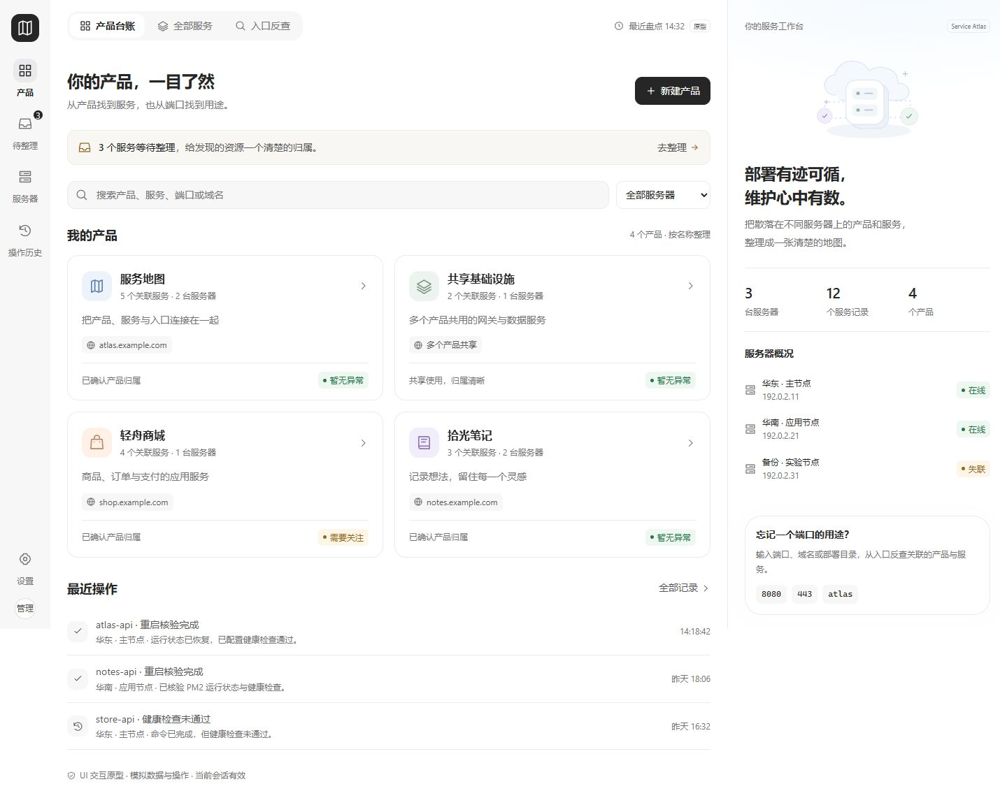

# 服务地图 · Service Atlas

把产品、服务、服务器和访问入口整理成一张可检索的地图。

服务地图面向维护 2–5 台 Linux 云服务器的管理员，帮助回答“这个产品在哪里运行”“8080 属于哪个服务”“该从哪里查看日志”。产品设计覆盖 Docker、Nginx、systemd、PM2、nohup 和手动启动等混合部署。

**当前仓库交付产品设计文档与可运行的 UI 交互原型。页面使用模拟数据，尚未实现真实 API、SSH 接入、鉴权或持久化，也不会执行真实服务器重启。**

## 当前进度

| 内容 | 状态 |
| --- | --- |
| 产品需求、体验流程、架构、接口、安全与验收规格 | 已完成开发基线 |
| 浅色工作台 UI、统一主题与响应式布局 | 已实现 |
| 产品创建和编辑、归属整理、搜索、日志与操作流程 | 已实现模拟交互 |
| 真实服务器采集、REST API、日志 SSE、数据库与登录 | 待实现或对接 |
| 真实重启、审计、备份恢复与生产验收 | 待实现和验证 |

业务文档基线为 1.0（2026-10-08），UI 规格与决策更新至 1.1（2026-10-09）。文档中的接口、命令、数据字段和性能目标属于后续实现契约。

## 界面预览



[操作历史效果](ui-prototype/review/upgraded-operations.jpg) · [手机服务详情效果](ui-prototype/review/upgraded-mobile-detail.jpg)

界面采用浅灰导航、白色工作区、深灰主按钮、细边框卡片和右侧上下文面板。桌面以 72px 导航和 400px 上下文栏组织内容；窄屏使用单列卡片、按需打开的详情面板与表格独立横向滚动。

## 快速运行

从仓库根目录启动静态服务：

```sh
python -m http.server 4173 --bind 127.0.0.1 --directory ui-prototype/dist
```

在浏览器打开 [http://127.0.0.1:4173](http://127.0.0.1:4173)。Windows 环境也可使用 `py -3` 替换 `python`。

运行页面仅需要 Python 3 和现代浏览器。原型使用原生 HTML、CSS 与 JavaScript，没有前端构建步骤或第三方运行依赖；无需执行 `npm install`。浏览器通过 HTTP 加载 ES modules，直接双击 HTML 文件不是支持的启动方式。

所有新建、编辑、关联和配置只在当前页面会话保留，刷新会恢复演示数据。

## 可以体验的流程

- **产品台账**：按名称查看产品，创建或编辑产品，进入关联服务清单。
- **服务定位**：通过产品名称、服务名称、端口、域名或目录搜索，并按服务器筛选；相同端口在不同服务器上分别展示。
- **待整理**：选择单条或多条资源，核对后关联产品；归属只改变台账。
- **服务详情**：切换概览、入口、日志和操作，分别查看运行、监听、健康与数据新鲜度。
- **日志阅读**：切换模拟来源，读取最近日志、开始或暂停跟随，以及控制自动滚动。
- **受控重启**：预览明确实例、代次、版本和影响产品，演示成功、检查失败与连接中断。
- **操作历史**：按进行中、核验完成、核验失败和结果未知筛选，查看过程和核验范围。
- **服务器与设置**：查看连接、采集覆盖和观察时间，体验模拟接入、指纹确认、刷新盘点与台账导出。

示例服务器使用保留网段 `192.0.2.0/24`，域名使用 `example.com`，不代表真实可访问的资源。原型不收集 SSH 凭据。

## 源码结构

```text
.
├── README.md                         # 项目介绍、启动和验证入口
├── DESIGN.md                         # 项目 UI 基线入口
├── 01-product-requirements.md         # 产品需求与 MVP 范围
├── 02-experience-and-flows.md          # 页面、路由和交互流程
├── 03-architecture-and-data.md        # 架构、实体与数据契约
├── 04-api-and-adapters.md             # REST、SSE 和采集适配契约
├── 05-delivery-and-acceptance.md      # 交付计划与验收矩阵
├── 06-security-and-operations.md      # 接入安全、运维与恢复
├── 07-decisions-and-references.md     # 已确认条件与设计决策
└── ui-prototype/
    ├── dist/
    │   ├── index.html                # 页面壳、语义结构与对话框
    │   ├── app.js                    # 渲染、路由和交互流程
    │   ├── data.js                   # 模拟台账与共享业务逻辑
    │   ├── theme.css                 # 统一设计变量
    │   └── styles.css                # 组件样式与响应式布局
    ├── tests/data.test.js            # 数据逻辑测试
    ├── review/                       # 桌面与手机效果截图
    ├── DESIGN.md                     # 完整视觉与组件规范
    ├── UX-CONTRACT.md                # 共享交互与组件归属
    ├── browser-verification.md       # 浏览器验证记录
    ├── premium-ui.json               # UI 审核配置
    ├── package.json                  # 语法检查与测试命令
    └── README.md                     # 原型说明
```

`dist/` 中的文件就是当前原型源码，不是由框架编译生成的产物。GitHub 仓库直接包含这些文件；本地发布配置、嵌套 Git 元数据、压缩包、依赖目录和运行数据不上传。

## 验证

需要 Node.js 18 或以上。从仓库根目录运行：

```sh
npm --prefix ui-prototype run check
npm --prefix ui-prototype test
```

语法检查覆盖 `app.js` 和 `data.js`。4 项逻辑测试覆盖：

1. 操作筛选保持未知结果，进行中只包含尚未结束的阶段。
2. 跨服务器端口搜索与容器内部端口匹配。
3. 归属关联发生冲突时整批不修改。
4. 离线、静态站点、共享 Nginx、活动操作和未知结果的重启阻断。

浏览器验证记录见 [browser-verification.md](ui-prototype/browser-verification.md)，涵盖桌面和手机布局、表单错误与未保存保护、归属整理、搜索、日志和未知结果处理。这些检查证明模拟流程可用，不替代真实服务、安全、性能或恢复验收。

## 产品文档

| 文档 | 内容 |
| --- | --- |
| [产品需求](01-product-requirements.md) | 用户场景、F-01 至 F-14、业务规则与首版范围 |
| [页面与流程](02-experience-and-flows.md) | 信息组织、路由、服务详情、整理、日志和异常交互 |
| [架构与数据](03-architecture-and-data.md) | 稳定台账、运行绑定、同步与操作状态 |
| [接口与适配](04-api-and-adapters.md) | REST、SSE、错误码与管理器采集契约 |
| [交付与验收](05-delivery-and-acceptance.md) | 阶段依赖、测试矩阵与发布 Gate |
| [部署安全与运维](06-security-and-operations.md) | 凭据、指纹、权限、日志、备份恢复与回退 |
| [决策与资料](07-decisions-and-references.md) | 已确认条件、默认方案、开工验证项与参考资料 |
| [UI 设计基线](DESIGN.md) | 用户确认的风格、统一主题与完整规范入口 |

首次阅读建议先看产品需求，再按职责阅读页面流程、接口或验收章节。

## 风格复用

当前 UI 已提炼为独立的 [浅色工作台风格包](ui-style/README.md)，包含配色与布局规范、可复制的 [CSS 变量](ui-style/theme.css)、[复用提示词](ui-style/PROMPT.md)和参考图。复制 `ui-style/` 到其他产品即可作为设计与实现输入；具体业务规则由目标产品定义。

## 后续真实数据接入

接入前需明确已有后端 API、后端项目、数据库或导出文件的位置；如果直接采集服务器，则先明确服务器清单、现有接入方式、运行用户、日志来源和动作权限。当前没有已配置的真实数据源。

正式产品的默认技术规划为 Go、React、TypeScript、Vite、Ant Design、SQLite，以及 REST 和 SSE。它们属于后续实现方案，当前原型没有这些依赖。建议实施顺序为：只读接入与主机身份确认 → 稳定台账及人工归属 → 来源明确的日志 → 有限重启与核验 → 备份恢复及试点验收。

后续实现应继续保持以下边界：

- 产品跨服务器聚合，服务身份与实际运行绑定分开；扫描不能覆盖人工归属和备注。
- 监听、宿主机发布、容器内部端口、域名路由和外部可达性分别表达。
- 运行、监听、健康和新鲜度分别展示；失联不能直接解释为停止。
- 一次重启只针对预览中的明确实例，不提供产品级全部重启；共享 Nginx 首版只读。
- 结果未知保持未知，不自动重发命令；只读核验与人工解锁有可追溯记录。

修改主题时同步 `theme.css` 与完整视觉规范；修改业务契约时同步需求、页面、接口和验收文档。
